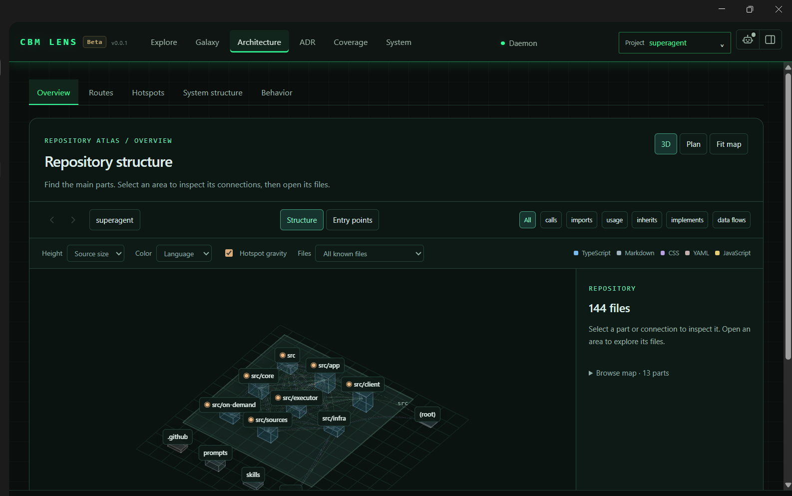

# dsh-plugin-cbm

**DeepSeek Harness (DSH) desktop plugin for [codebase-memory-mcp](https://github.com/DeusData/codebase-memory-mcp)** — 17 MCP code-graph tools in every session, a graph-first exploration policy in the system prompt, and the binary's own **CBM Lens** visualization embedded as a sidebar panel.

为 DeepSeek Harness(Windows 桌面端)集成 codebase-memory-mcp 的插件:会话常驻 17 个代码图谱 MCP 工具、系统提示注入"图谱优先"探索策略、侧栏面板内嵌 CBM Lens 可视化界面(前端完全复用 cbm 二进制自带 UI,零改写)。



*CBM Lens(Explore / Galaxy / Architecture / ADR / Coverage / System)完整嵌入 DSH 侧栏面板——图为 superagent 项目的 3D 架构图(Repository Atlas · Overview)。*

## 它做了什么 / What it does

| 能力 | 实现 |
|---|---|
| **MCP 工具接入** | `cordis.patch.yml` 插入 `@deepseek-ai/dsh-mcp-client`(stdio)连接本地 `codebase-memory-mcp.exe --ui=true --port=9749`,工具名 `mcp__cbm__*`(search_graph / trace_path / get_code_snippet / detect_changes 等 17 个) |
| **图谱优先策略** | `index.js` 注册系统提示区段 `cbm:code-exploration-policy`:所有会话默认先用图谱查询代替 grep/逐文件读,附带覆盖核验、防"图里没有=不存在"误判等护栏 |
| **CBM Lens 面板** | `client.js` 注册 `sidebar.panellist` 图标 + `main` 中央面板,iframe 内嵌 Lens 完整版;健康探测(带诊断输出)、启动期快速重试、乐观渲染兜底、浏览器逃生链接 |
| **会话标签页速览** | 每个会话头部"对话 / 轨迹 / **CBM Lens**"第三个标签(v1.5.0):原生信息条(项目 · 分支 · 状态点 · 节点/边数 · 索引时间 · 刷新/完整版)+ 精简嵌入的 Architecture **Plan 2D 图 + Browse map** |
| **Loopback 反代** | `index.js` 在 `127.0.0.1:9751` 起透明代理转发 Lens,解开三道嵌入防线(见下文);对 `dshembed=1` 的 HTML 注入精简外壳 CSS + 一次性 Plan 切换脚本,Lens 本体 9749 零改动 |

## 会话标签页"项目速览"(v1.5.0)

每个会话(按其工作区)自动定位所属 cbm 项目,标签页内呈现:

- **信息条**(原生 React,主题 token):项目名 · 分支 · 状态点 · 节点/边数 · 索引时间,右侧 [刷新] [完整版 ↗](完整版一键跳侧栏完整面板,`ctx.layout.selectPanel`)
- **图面**:iframe 指向 `?project=<名>&workspace=architecture&dshembed=1`,代理为该 HTML 注入:
  - 精简 CSS——隐藏 `atlas-header`(全局导航)/`atlas-tabs-bar`(子页签)/`atlas-statusbar`/`atlas-breadcrumb` 等,**只留 Plan 图 + Browse map(atlas-tree)**,全部选择器用 Lens 稳定的 `data-testid`,升级漂移时优雅降级回完整 UI
  - 一次性 JS——检测 `architecture-scene` 为 3d 时程序化点击 "Plan"(Lens 自身按项目持久化该选择),并派发 resize 让画布贴合 iframe
- **项目匹配**:会话 cwd ↔ 索引根目录**双向匹配**(相等 > 工作区在项目内取最深 > 项目在工作区内取最浅),适配"工作区是仓库外层文件夹"的常见组织方式;未索引显示引导卡

## 三道嵌入防线(踩坑记录,最有价值的部分)

Lens 的 HTTP 服务有三层安全设计,直接 iframe 会得到空白面板。本插件的反代逐一化解:

| # | 防线 | 现象 | 代理对策 |
|---|---|---|---|
| 1 | CSP `frame-ancestors 'none'` | iframe 被浏览器丢弃 → 面板空白 | 转发时仅剥离 `frame-ancestors` 指令,其余 CSP 原样保留 |
| 2 | DSH 桌面端 GUI 运行于特权 `dsh-app://` scheme,Chromium 视其为"公共"地址空间 → 对 loopback 的 fetch 触发 **Private Network Access 预检** | 页面内探测请求被拒(`Failed to fetch`),但 curl/PowerShell 一切正常(极易误诊) | 直接应答 OPTIONS 预检:`204` + `Access-Control-Allow-Private-Network: true` |
| 3 | cbm 服务按 `Origin` 头拒绝跨源请求(CSRF 防护) | `HTTP 403`(探测能拿到状态码但被拒) | 转发前剥掉 `Origin` 头 |

另:**DSH 的 Host 插件模块修改后,开关切换 / 重装 bundle 都不会热加载新模块代**(官方约定:替换已装包需重启加载新代;旧监听器还可能继续占端口)。因此 v1.3.0 把代理端口从 9750 迁到 9751 以便新旧共存;改了 `index.js` 后请重启 DSH 生效,只改 `client.js` 则 F5 刷新页面即可。诊断脚本见 `tools/`(未随插件分发)。

## 安装 / Install

前提:
- Windows + DeepSeek Harness 桌面端(带插件系统)
- codebase-memory-mcp 已安装(`install.ps1 --skip-config`,默认装到 `%LOCALAPPDATA%\Programs\codebase-memory-mcp`):

```powershell
Invoke-WebRequest -Uri https://raw.githubusercontent.com/DeusData/codebase-memory-mcp/main/install.ps1 -OutFile install.ps1
Unblock-File .\install.ps1
.\install.ps1 --skip-config
```

安装本插件(在 DSH 会话中让 agent 执行,或任何能调用 `plugin_manager` 的入口):

```
plugin_manager { action: install_bundle, target: "<本仓库克隆的绝对路径>" }
```

重启 DSH 后生效:侧栏出现 CBM Lens 图标;agent 获得 `mcp__cbm__*` 工具;会话头部出现 CBM Lens 标签。

> **升级本插件后**:改了 `client.js` → F5 刷新即可;改了 `index.js`(Host)→ 需重启 DSH(见上文模块代说明)。

## 配置 / Configuration

- **exe 路径**:`cordis.patch.yml` 中 `command` 通过 `!!js` 读 `process.env.LOCALAPPDATA`,无硬编码用户名
- **端口**:`index.js`(`PROXY_PORT = 9751`)+ `client.js`(`PROXY_URL`);cbm 端口 `--port=9749` 在 `cordis.patch.yml` 的 args
- **工具调用超时**:已放宽到 10 分钟(`toolCallTimeoutMs: 600000`),大仓库建议 `index_repository(async: true)` + `status: true` 轮询
- **面板文案**:`locale/en.json`、`locale/zh.json` + `client.js` 内置字典(双保险)

## 排障 / Troubleshooting

面板错误卡会显示"探测结果"诊断行:

| 诊断 | 含义 | 处理 |
|---|---|---|
| `none: Failed to fetch...` | 代理不可达(插件未激活/端口被占) | 重载插件或重启 DSH |
| `cors: HTTP 502` | 上游 cbm 未就绪(常见于应用刚启动的窗口) | 等待自动重试(1s/3s/7s/10s 阶梯),面板会在就绪后自动加载/刷新 |
| `cors: HTTP 403` | Origin 未剥(旧版代理) | 确认运行 v1.3.0+ |
| 空白 iframe | frame-ancestors 未剥或被 CSP 拦截 | 同上;右下角"在浏览器中打开"可随时逃生 |

## 许可 / License

- 本插件代码:MIT © 2026 JACKWang19559
- [codebase-memory-mcp](https://github.com/DeusData/codebase-memory-mcp):MIT © DeusData(本插件不包含其代码,只做集成;CBM Lens 前端版权归上游)
